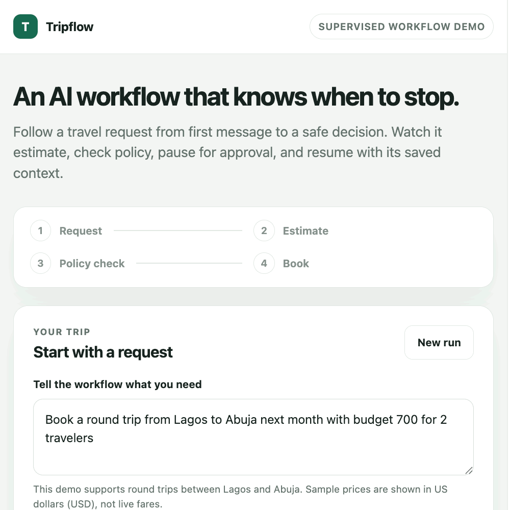

# Tripflow — AI Travel-Booking Workflow

Tripflow is an AI project that builds a travel-booking autonomous workflow. It brings together **orchestration, autonomy, checkpoints, and observability** to show how a travel assistant can coordinate trip-planning tasks, act within policy, pause for human approval, and resume with its saved context.



The workflow is deterministic, not powered by a live AI model: routes, prices, insurance estimates, and booking references are simulated. Prices are illustrative USD estimates, not live quotes, and the app does not make real reservations.

## Features

- Collect and update trip details through a conversational interface.
- Estimate flight, lodging, and insurance costs.
- Check trip budgets and configurable approval thresholds.
- Complete eligible requests automatically or pause for human approval.
- Save workflow state and resume after approval.
- Inspect an event trace of workflow actions and decisions.

## Run locally

Requirements: Python 3.12 or later and [uv](https://docs.astral.sh/uv/).

```bash
uv sync
uv run uvicorn main:app --reload --port 8014
```

Open [http://127.0.0.1:8014/](http://127.0.0.1:8014/) in a browser.

## Try the workflow

The default estimate for one traveler is **$310**: $150 for a return flight, $150 for a five-night lodging allowance, and $10 for insurance. The default approval threshold is **$600**.

- **Automatic completion:** request a Lagos–Abuja round trip for one traveler.
- **Approval and resume:** request the same trip for two travelers with a budget of $700. The $620 estimate pauses for approval; approve it and resume from the checkpoint.
- **Budget enforcement:** request a budget below the estimate, such as $300 for one traveler. The workflow stops and asks for a revised budget.

All amounts are illustrative. No live travel services are contacted.

## Project structure

- `app_models.py`: workflow state, policy, quote, trace, and API models.
- `checkpoint_store.py`: JSON checkpoint persistence.
- `orchestration.py`: request handling, estimates, policy decisions, approvals, and resumption.
- `webapp.py`: FastAPI endpoints and static file serving.
- `static/`: browser application.
- `tests/`: API and workflow behavior tests.

## Run tests

```bash
uv run --with pytest pytest -q
```
